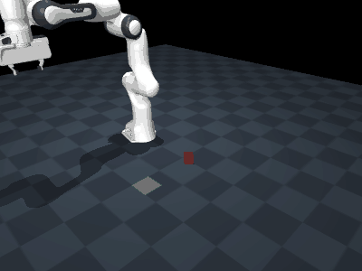
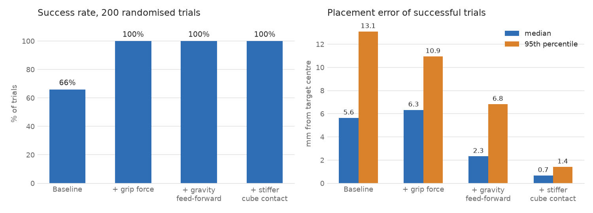
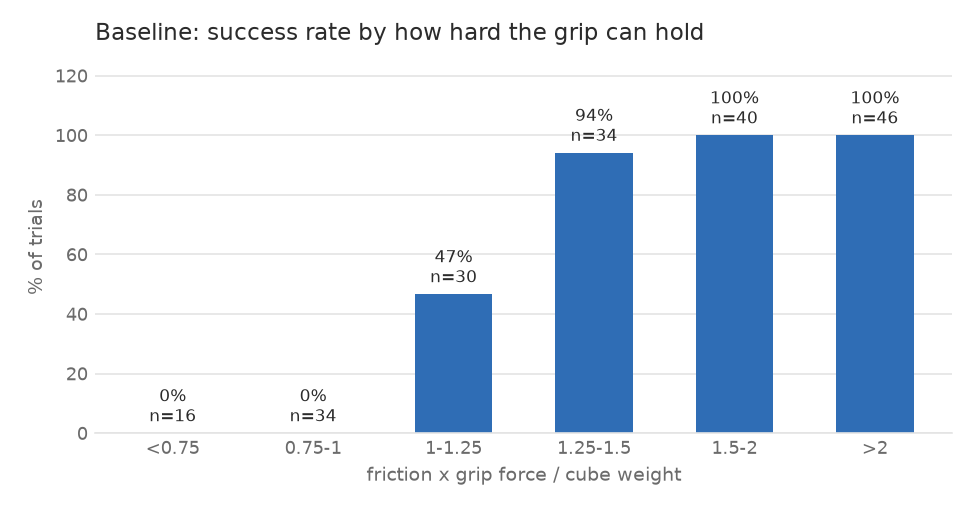
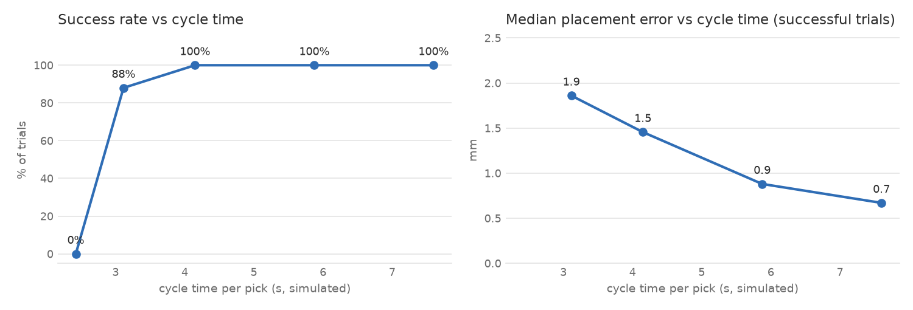

# Pick and place with a simulated Franka Panda


A Franka Emika Panda arm in MuJoCo finds a cube with an overhead depth camera, picks it up and puts it on a target. Cube position, rotation, size, mass and friction change every trial, and every trial is scored, so changes to the controller are judged on a few hundred runs rather than on one that looked fine.



## Results

200 randomised trials per run, same 200 scenes for every run.

| Version | Success | Placement error, median / 95th pct |
|---|---|---|
| Baseline | 132/200 (66%) | 5.6 / 13.1 mm |
| + realistic grip force | 200/200 | 6.3 / 10.9 mm |
| + gravity feed-forward on the joints | 200/200 | 2.3 / 6.8 mm |
| + stiffer cube contact | **200/200** | **0.67 / 1.4 mm** |



Perception, measured against the simulator's ground truth: median position error 0.46 mm (worst 1.4 mm), median rotation error 0.2° (worst 3.5°).

What each fix was and how the numbers pointed to it is in [HOW_IT_WORKS.md](docs/HOW_IT_WORKS.md#what-went-wrong-and-how-it-was-fixed). In short: the stock gripper squeezes with about 2 N, so heavy, slippery cubes fell out (every trial where friction × grip force was below the cube's weight failed); the joint servos sagged under gravity; and MuJoCo's default soft contacts let the cube creep in the fingers.



### How fast can it go?

`--time-scale` shortens every motion by the same factor.

| Cycle time per pick | Success | Placement error, median |
|---|---|---|
| 7.6 s (default) | 200/200 | 0.67 mm |
| 5.9 s | 200/200 | 0.88 mm |
| 4.2 s | 200/200 | 1.5 mm |
| 3.1 s | 176/200 (88%), all failures `grasp_slipped` | 1.9 mm |
| 2.4 s | 0/200 | – |



4.2 s is the fastest setting with no failures, 45% quicker than the default. Below that the joint servos can't keep up: at 2.4 s the gripper is still about 56 mm short of its commanded position when the fingers close (6 mm at the default speed), so most grasps close on air or catch the cube by an edge. Keeping the gripper's close time at its default while speeding up only the arm lifts 3.1 s to 55/60 in a smaller test, but doesn't rescue 2.4 s, so the limit is the arm's tracking, not the gripper.

### Depth noise

Adding Gaussian noise to every depth pixel (100 trials each): with 2 mm of noise, 100/100 succeed; with 5 mm, 100/100, median perception error 0.79 mm (from 0.46 mm), placement 0.80 mm. Averaging over a few hundred pixels of the cube's top face absorbs most of it.

## How it works

| Part | File | What it does |
|---|---|---|
| Scene | `pickplace/scene.py` | Loads the Panda from MuJoCo Menagerie with `MjSpec`, adds floor, cameras, target and a randomised cube |
| Perception | `pickplace/perception.py` | Colour + depth image from the overhead camera → red pixels → 3D points → cube centre, size and rotation |
| IK | `pickplace/ik.py` | Damped least-squares inverse kinematics with a null-space pull towards a home posture |
| Controller | `pickplace/controller.py` | Approach, descend, grasp, lift, transport, place; checks after each step and names the failure |
| Evaluation | `pickplace/evaluate.py` | Runs N trials in parallel, writes `trials.csv` and `summary.json` with a 95% confidence interval |

Each trial ends with one of: success, `not_detected`, `unreachable`, `grasp_missed`, `grasp_slipped`, `dropped_in_transport`, `tipped_over`, `off_target` (more than 20 mm from the target centre).

## Running it

Needs Python 3.10+. On Windows:

```
git clone https://github.com/DreamDiver001/mujoco-pick-place.git
cd mujoco-pick-place
py -3.13 -m venv .venv
.venv\Scripts\activate
pip install -r requirements.txt
python scripts/fetch_panda.py
```

`fetch_panda.py` downloads the Panda model (about 33 MB of meshes) from MuJoCo Menagerie into `third_party/`. It isn't stored in this repo.

Watch one trial in the MuJoCo viewer (different `--seed`, different scene):

```
python -m pickplace.demo --seed 1004
```

Run the evaluation and tests:

```
python -m pickplace.evaluate --trials 200 --name my_run
pytest
```

The fixes can be switched off to reproduce the earlier rows of the table:

```
python -m pickplace.evaluate --stock-gripper --no-gravity-ff --soft-contact --name 1_baseline
python -m pickplace.evaluate --no-gravity-ff --soft-contact --name 2_grip_force
python -m pickplace.evaluate --soft-contact --name 3_gravity_ff
python -m pickplace.evaluate --name 4_stiff_contact
python scripts/make_report.py
```

Other options: `--time-scale 0.5` runs every motion twice as fast, `--depth-noise 0.002` adds 2 mm of noise to the depth image.

On Linux without a display, set `MUJOCO_GL=egl` for the camera rendering. On macOS the viewer needs `mjpython` instead of `python`.

## Tests

17 tests: scene contents, IK accuracy at points across the workspace, gripper orientation, cube detection accuracy over 10 random scenes, detecting a missing cube, full pick-and-place runs, an empty grasp being caught, an unreachable cube being refused, and the summary statistics. GitHub Actions runs them plus a 50-trial evaluation that fails the build below 95% success.

## Limits

- The cube's pose comes from a rendered image, but rendering is perfect: no lens distortion, motion blur or lighting changes, and the cube is the only red thing in the scene.
- One object, on a flat floor, with nothing to avoid. There's no collision-aware motion planning.
- The fixes to the gripper and contact model make the simulation more realistic, but they're my estimates, not values measured on a real robot.
- Python only; a real deployment would more likely use ROS 2 with C++ controllers.

## Credits

Panda model from [MuJoCo Menagerie](https://github.com/google-deepmind/mujoco_menagerie) (Apache-2.0), downloaded at a fixed commit by `scripts/fetch_panda.py`.
